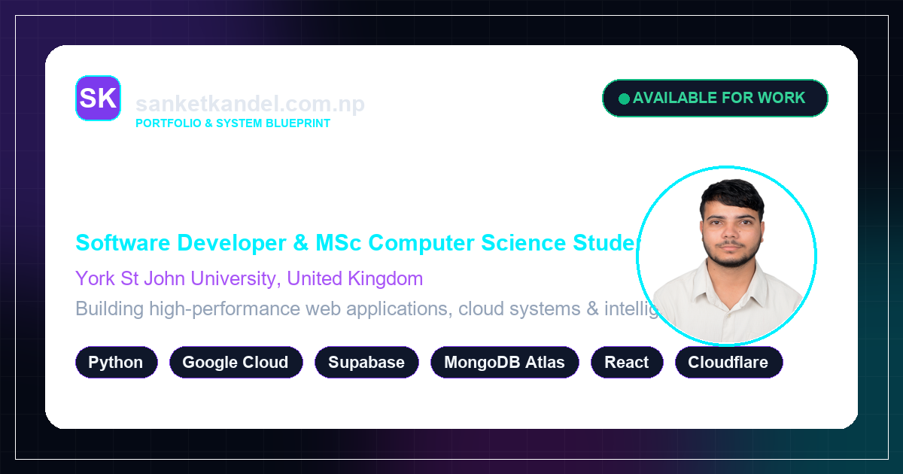

# Sanket Kandel — Portfolio & Systems Architecture

<div align="center">
  
  <br /><br />
  <a href="https://sanketkandel.com.np"></a>
  <a href="https://sanketkandel.com.np/now.html"></a>
  <a href="mailto:info@sanketkandel.com.np"></a>
</div>

<br />

Welcome to the official source code for **[sanketkandel.com.np](https://sanketkandel.com.np)** — the personal website, systems architecture blueprint, and research log of **Sanket Kandel**, Software Developer and postgraduate Master of Science (MSc) in Computer Science student at **York St John University, United Kingdom**.

---

## 🚀 Key Highlights & Stack

- **Frontend & Design System**: Modular HTML5 & Vanilla CSS with design tokens, glassmorphism UI, theme switcher, responsive navigation drawer, and fluid micro-animations.
- **Backend & Cloud Infrastructure**:
  - **Python & FastAPI**: Asynchronous microservices and background job workers.
  - **Google Cloud Platform (GCP)**: Cloud Run containerized runtimes and Vertex AI integration.
  - **Supabase & PostgreSQL**: Row-Level Security (RLS) data policies, real-time WebSockets, and `pgvector` semantic document retrieval.
  - **MongoDB Atlas**: High-throughput telemetry ingestion, time-series aggregations, and Atlas Vector Search.
  - **Cloudflare Edge Compute**: Cloudflare Workers, KV store, and zero-cold-start asset caching.
- **Brand Identity & SEO**: Open Graph preview card (1200x630), vector SVG favicon, Schema.org JSON-LD structured data, and automated XML sitemap.
- **Dedicated `/Now` Page**: Real-time snapshot of active academic pursuits at York St John University, ongoing codebases, and systems reading list ([sanketkandel.com.np/now.html](https://sanketkandel.com.np/now.html)).

---

## 📁 Repository Structure

```text
├── assets/                 # High-resolution brand assets, OG card, SVG favicon, CV
├── cloudflare-worker/      # Cloudflare Worker API & KV seed generator
├── index.html              # Homepage with hero, typewriter, and featured stack
├── about.html              # Engineering journey, philosophy, and education
├── now.html                # Dedicated /Now page (York St John MSc, stack, reading)
├── projects.html           # Full portfolio (Python, GCP, Supabase, MongoDB Atlas)
├── skills.html             # Categorized technical competencies and certifications
├── blog.html               # Engineering blog list and search filters
├── blog-post.html          # Dynamic article renderer
├── contact.html            # Contact portal and direct routing to info@sanketkandel.com.np
├── tracker.js              # Privacy-friendly edge analytics & outbound click tracking
├── sitemap.xml             # XML sitemap for search engine indexing
├── robots.txt              # Crawler instructions
└── wrangler.jsonc          # Cloudflare static assets configuration
```

---

## 🛠️ Local Development & Deployment

To run the site locally:

```bash
# Using Python built-in server
python -m http.server 8080
```

To deploy static assets and worker to Cloudflare:

```bash
# Deploy static assets
npx wrangler deploy

# Deploy backend worker
cd cloudflare-worker && npx wrangler deploy
```

---

## 📬 Contact & Connect

- **Website**: [sanketkandel.com.np](https://sanketkandel.com.np)
- **Direct Email**: [info@sanketkandel.com.np](mailto:info@sanketkandel.com.np)
- **LinkedIn**: [linkedin.com/in/sanketkandel](https://linkedin.com/in/sanketkandel)
- **GitHub**: [github.com/virt-sanket](https://github.com/virt-sanket)
